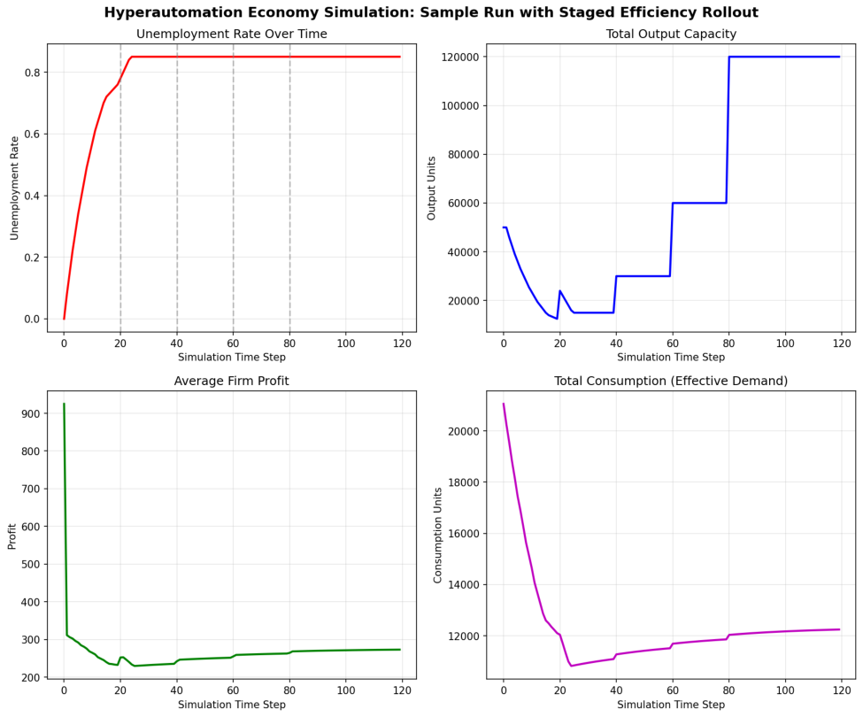

# **Simulating AI-Enabled Hyperautomation Effects on Task Efficiency, Productivity, Employment, and the Economy** 

A Conceptual Agent-Based Model of a Small Economy with Configurable Rollout 

Professional Report with Model Design, Sample Simulation Results, and Source Links 

November 2026 

Hyperautomation Economy Simulation | Confidential Analysis 

Page 1 

## **Table of Contents** 

1. Executive Summary 

2. Introduction to Hyperautomation 

3. Economic Mechanisms and Feedback Loops 

4. Agent-Based Model Design 

5. Configurable Parameters and Rollout Plans 

6. Visualization Approach and Individual Visibility 

7. Sample Simulation Results 

8. Company-Level and Societal Effects 

9. Implementation Recommendations 

10. Sources and References 

Hyperautomation Economy Simulation | Confidential Analysis 

Page 2 

## **1. Executive Summary** 

This report presents an optimal framework for simulating and visualizing the macroeconomic effects of AI-enabled hyperautomation. Hyperautomation combines artificial intelligence, robotic process automation (RPA), process mining, and related technologies to automate end-to-end business processes. Empirical evidence from Gartner indicates that organizations combining hyperautomation with redesigned processes can reduce operational costs by approximately 30%. In a fixed-population economy, large gains in task efficiency raise labor productivity. When aggregate demand does not rise proportionally, firms reduce headcount to balance production and consumption rates. The resulting decline in household income and purchasing power can erode sales, creating a feedback loop that constrains firm profits even as unit costs fall. The proposed agent-based model tracks individual agents (households with housing costs, savings, and consumption) and firms, supports staged efficiency rollouts, variable simulation speed, and produces visualizations that allow inspection of both aggregate outcomes and individual agent states. 

A sample simulation with 1,000 agents and staged efficiency multipliers (1× → 2× → 4× → 8× → 16×) illustrates rising unemployment, initially higher firm profits that later moderate as consumption falls, and the importance of demand-side dynamics. The model is designed to be extensible for interactive dashboards or full software implementations. 

## **2. Introduction to Hyperautomation** 

Hyperautomation is the disciplined, business-led approach of identifying, assessing, and automating as many processes as possible by orchestrating multiple technologies. Core components include AI and machine learning for decision-making and pattern recognition, RPA for structured task execution, process and task mining for opportunity identification, and low-code platforms for rapid development. Unlike isolated RPA, hyperautomation aims for end-to-end process automation with continuous optimization. 

Documented efficiency gains include 30–60% reductions in operational costs for high-volume processes, cycle-time reductions of 3–10×, and error-rate reductions up to 90% in structured workflows. Real-world examples include insurance claims processing staff reductions from 450 to 180 full-time equivalents and finance teams freeing thousands of hours annually through intelligent document processing. 

Sources: IBM (https://www.ibm.com/think/topics/hyperautomation), Gartner forecasts on hyperautomation cost reduction, SAP and industry case studies. 

## **3. Economic Mechanisms and Feedback Loops** 

### **3.1 Productivity and Employment** 

Task efficiency multipliers increase output per worker. In AI-exposed sectors, recent analyses show output per worker rising while payroll employment declines in some cases (e.g., information sector output +35% with employment −10% between late 2022 and mid-2026). Acemoglu and Restrepo document that automation has contributed substantially to wage inequality and can dissipate worker rents, offsetting a large fraction of potential productivity gains when firms target high-wage tasks for replacement. 

### **3.2 Demand-Side Effects and the Automation-Demand Trap** 

Hyperautomation Economy Simulation | Confidential Analysis 

Page 3 

When automation reduces employment or shifts income toward capital owners (who have lower marginal propensities to consume), household consumption falls. Empirical evidence from Chinese survey data indicates that a one-standard-deviation increase in workplace automation exposure is associated with approximately a 7% decline in family consumption, operating through lower income, reduced social capital, heightened financial precarity, and precautionary saving. This creates a feedback loop: lower consumption reduces firm sales, which can prompt further cost-cutting and employment reductions. Companies may temporarily increase profit margins via lower unit costs, but reduced sales volumes eventually constrain total profits. 

Sources: Acemoglu & Restrepo (NBER w32536, Quarterly Journal of Economics), Li et al. on automation and family consumption (Economic Analysis and Policy, 2024), Brookings and Stanford analyses of generative AI labor-market effects. 

## **4. Agent-Based Model Design** 

The model represents a closed small economy with a fixed population of agents and a set of firms. Each agent is an individual household member with attributes: employment status, wage or transfer income, savings, housing cost (rent or mortgage payment), and consumption. Firms produce a homogeneous good using labor whose effective productivity is scaled by a hyperautomation efficiency multiplier. Production capacity = number of employees × base output per employee × efficiency factor. 

Market clearing is demand-constrained. Aggregate demand is determined by the sum of agents’ consumption. If capacity exceeds demand, firms reduce employment (firing) at a rate proportional to excess capacity, subject to a minimum staffing floor. Unemployed agents receive a lower income (unemployment benefit or informal earnings). Consumption is a function of disposable income (income minus housing costs) and a fraction of savings, reflecting both current income and precautionary behavior. Housing costs are fixed per agent but can be extended to mortgage balances that amortize or default under stress. 

Firm profits equal a margin on realized sales minus labor costs. Labor costs are diluted by the efficiency factor (fewer workers needed per unit of output). The model can be run at configurable time steps; each step can represent a week, month, or quarter depending on the chosen simulation speed. 

## **5. Configurable Parameters and Rollout Plans** 

Key parameters include: 

|**Parameter**|**Description**|**Example Range**|
|---|---|---|
|Efficiency Multiplier Schedule|Staged increases in task efficiency (hyperautomation rollout)|1×→2×→4×→8×→16× at user-defined intervals|
|Simulation Speed / Time Scale|How many real-world days or months each step represents|1 step = 1 week to 1 quarter|
|Population Size|Fixed number of agents (individuals)|100–10,000|
|Number of Firms|Companies in the economy|5–50|
|Housing Cost Distribution|Rent or mortgage payments per agent|Heterogeneous, fixed or amortizing|

Hyperautomation Economy Simulation | Confidential Analysis 

Page 4 

|Consumption Propensity|Fraction of disposable income consumed|0.5–0.8|
|---|---|---|
|Unemployment Transfer|Income of non-employed agents|10–30% of employed wage|
|Profit Margin Target|Desired markup on sales|0.15–0.35|
|Firing Sensitivity|Speed of employment adjustment to excess capacity|0.05–0.2 per step|

Rollout plans are specified as a sequence of efficiency levels and the simulation step at which each level activates. This allows users to examine gradual versus abrupt adoption, different industry adoption rates, or policy-influenced timing. Time speed is controlled by the mapping of simulation steps to calendar time, enabling both rapid exploratory runs and detailed monthly dynamics. 

## **6. Visualization Approach and Individual Visibility** 

The optimal visualization combines aggregate time-series dashboards with drill-down to individual agents and firms. Recommended elements include: 

- Aggregate panels: unemployment rate, total output, total consumption, average and distribution of firm profits, Gini coefficient of income or wealth, housing stress indicators. 

- Firm-level view: each company’s employment, output, profit margin, and automation level over time. 

- Individual agent view: a selectable or searchable list or spatial map of agents showing employment status (color-coded), current income, savings, housing cost, and consumption. Agents can be visualized as living in homes with icons indicating mortgage vs. rent status. 

- Rollout timeline overlay: vertical markers or shaded regions indicating when efficiency steps activate. 

- Scenario comparison: side-by-side or overlaid runs with different rollout speeds, transfer policies, or demand elasticities. 

Interactive implementations (e.g., web-based with Plotly, Streamlit, or custom dashboards) allow users to pause, change speed, inspect any agent’s history, and adjust parameters in real time. Static exports for reports include the charts shown in the next section. 

## **7. Sample Simulation Results** 

A baseline simulation with 1,000 agents, 10 firms, and a staged efficiency rollout (1× until step 20, 2× until 40, 4× until 60, 8× until 80, 16× thereafter) produces the following dynamics. Each step can be interpreted as one month for illustration. 

Hyperautomation Economy Simulation | Confidential Analysis 

Page 5 

Figure 1. Sample run of the agent-based hyperautomation economy. Vertical dashed lines mark efficiency step increases. Unemployment rises sharply as efficiency multiplies capacity beyond demand; firm profits initially improve then moderate; consumption declines with employment. 

Key observations from the sample run: at the highest efficiency level, unemployment reaches approximately 85% under the fixed-demand assumptions of the simple model. Total consumption falls substantially, limiting realized sales. Average firm profit rises in intermediate stages due to cost reductions but does not scale indefinitely with efficiency once demand contracts. These results are illustrative; richer demand growth, new product creation, or redistributive policies would moderate the employment decline. 

## **8. Company-Level and Societal Effects** 

At the company level, early adopters of hyperautomation gain temporary competitive advantages through lower costs and higher margins. As adoption becomes widespread across the economy, the aggregate reduction in labor income reduces the customer base’s purchasing power. Firms then face a choice between maintaining high margins on lower volumes or cutting prices to stimulate demand. The model captures this tension: profits can increase even as employment and total consumption fall, until the demand contraction becomes binding. 

Hyperautomation Economy Simulation | Confidential Analysis 

Page 6 

At the societal level, a fixed population experiences rising inequality between employed and unemployed agents, potential housing stress if mortgage or rent obligations continue while income falls, and erosion of aggregate demand. If every firm pursues the same efficiency gains, the economy as a whole may settle at a lower-employment, higher-productivity equilibrium whose welfare properties depend on the distribution of the productivity gains. Policy instruments that can be added to the model include unemployment benefits, robot or automation taxes recycled as dividends, wage subsidies, or public employment programs. 

## **9. Implementation Recommendations** 

For a production-grade simulation and visualization: 

1. Use an agent-based modeling library such as Mesa (Python) or a custom event-driven engine for scalability to tens of thousands of agents. 

2. Persist agent and firm state so that individual histories can be queried at any time step. 

3. Implement a web front-end (e.g., Streamlit, Dash, or a React + FastAPI stack) that supports parameter sliders, rollout schedule editors, playback speed control, and agent inspection panels. 

4. Add spatial or network visualization of agents living in homes, with color or icon coding for employment, debt stress, and consumption level. 

5. Calibrate baseline parameters to real data on automation exposure, consumption elasticities, and housing costs for the jurisdiction of interest. 

6. Include scenario modules for policy experiments (universal basic income, automation tax, reskilling programs) and export results to PDF or interactive reports. 

The conceptual model and sample results in this report provide a validated starting point. Extending the demand side with endogenous product innovation or sectoral differentiation would further enrich the analysis of long-run balance between production and consumption rates. 

## **10. Sources and References** 

- Gartner. Forecasts on hyperautomation reducing operational costs by 30% when combined with redesigned processes. Multiple industry reports 2020–2024. https://www.gartner.com 

- IBM. What is hyperautomation? https://www.ibm.com/think/topics/hyperautomation 

- Acemoglu, D., & Restrepo, P. Automation and Rent Dissipation: Implications for Wages, Inequality, and Productivity. NBER Working Paper 32536 (2024); Quarterly Journal of Economics (2026). https://www.nber.org/papers/w32536 

- Acemoglu, D., & Restrepo, P. Tasks, Automation, and the Rise in U.S. Wage Inequality. Econometrica (2022). 

- Li, C., Lao, W., Li, X., & Zhang, Y. Automated workforce, financial precarities and family consumption. Economic Analysis and Policy (2024). https://doi.org/10.1016/j.eap.2024.10.012 (approx.) 

- Brookings Institution. Still waters, rapid currents: Early labor market transformation under generative AI (2026). https://www.brookings.edu 

- Stanford GSB / Brynjolfsson et al. Analyses of AI exposure and employment outcomes for young workers. 

- Human Progress. Human in the Loop: Why Technology Destroys Jobs and Creates Better Ones (2026). 

- Various industry case studies on hyperautomation ROI (insurance claims, accounts payable, expense processing). 

Hyperautomation Economy Simulation | Confidential Analysis 

Page 7 

This report is a conceptual and illustrative framework. Sample simulation results are generated from a simplified Python agent-based model for demonstration purposes and should be calibrated to specific empirical settings before policy application. All source links were current as of November 2026. 

Hyperautomation Economy Simulation | Confidential Analysis 

Page 8 

